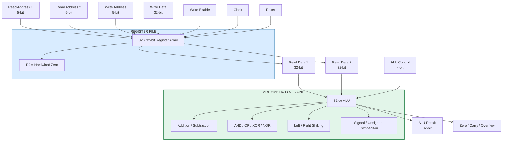
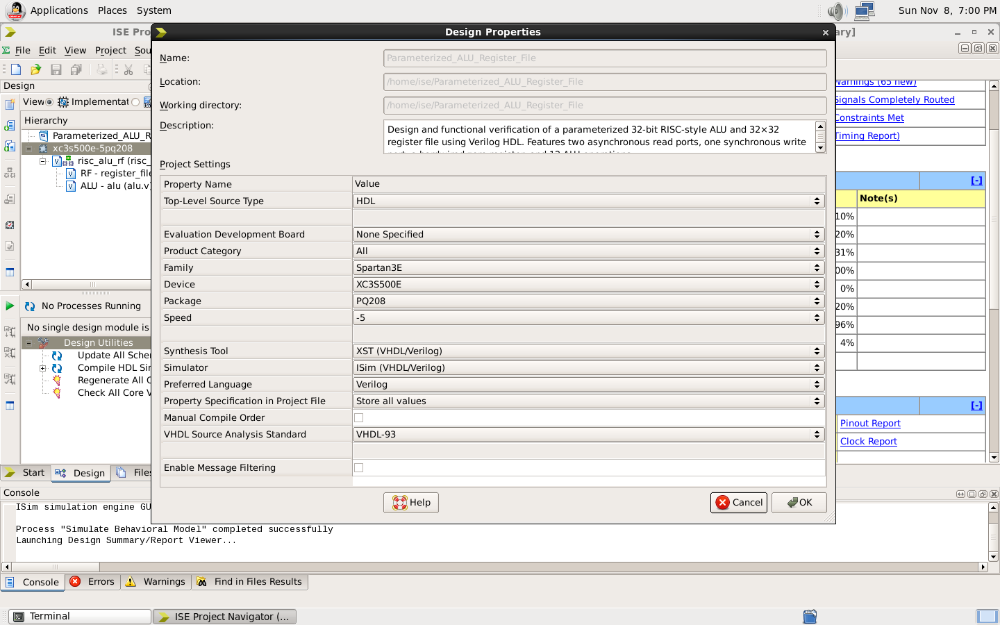
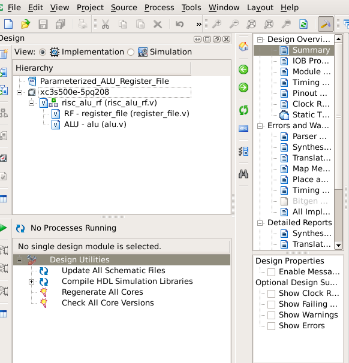
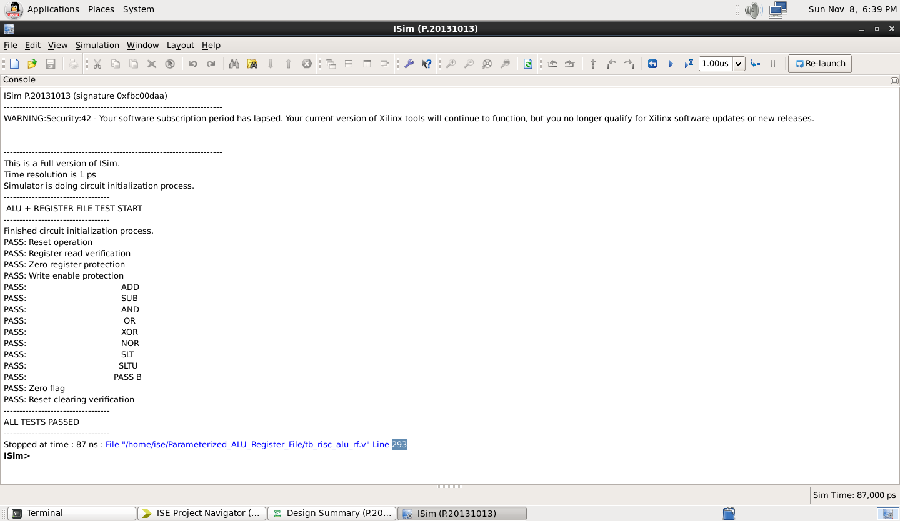
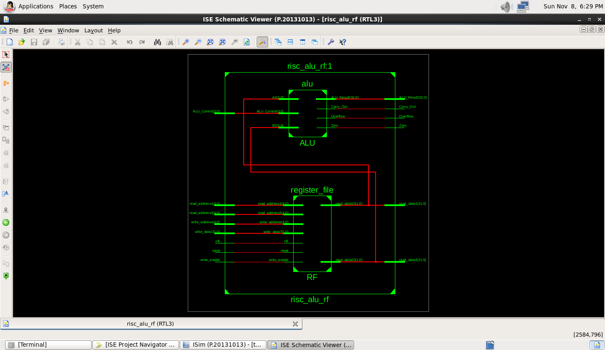
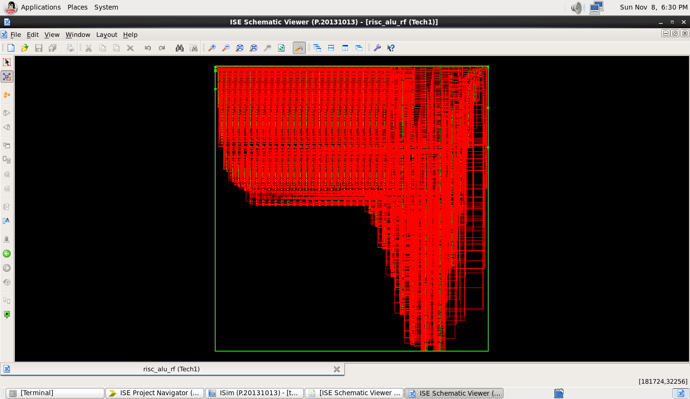
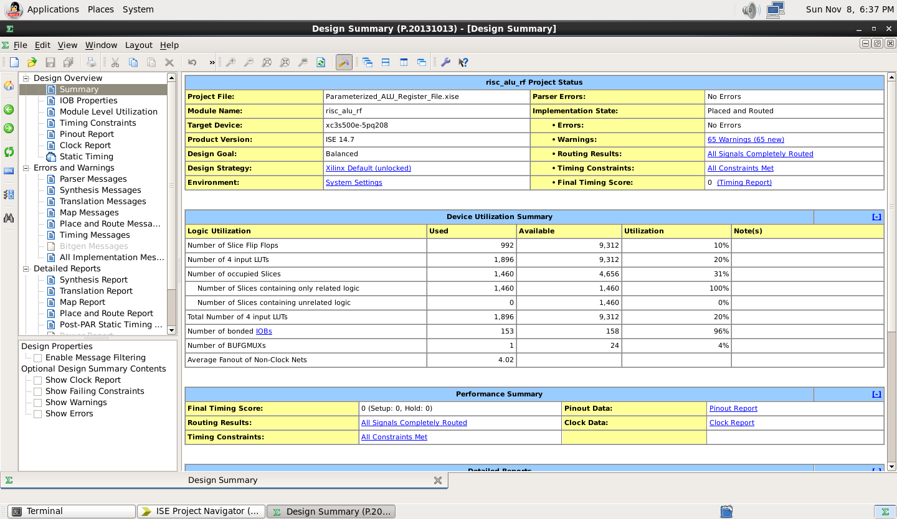
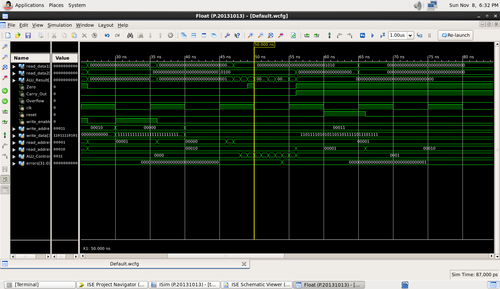

# 32-Bit RISC-Style Parameterized ALU + Register File
### Verilog HDL | Xilinx ISE 14.7 | Spartan-3E FPGA (XC3S500E)

<p align="center">

  
  
  
  

</p>

---

## 1. Project Overview

This project implements a **parameterized 32-bit RISC-style Arithmetic Logic Unit (ALU) and Register File** using Verilog HDL.

The design combines two important components of a processor:

1. **Arithmetic Logic Unit (ALU):** Performs arithmetic, logical, comparison and shift operations.
2. **Register File:** Stores data temporarily and provides operands to the ALU.

The project is developed and simulated using **Xilinx ISE Design Suite 14.7** and targets the **Xilinx Spartan-3E XC3S500E-5PQ208 FPGA**.

The design includes:

- 32-bit configurable ALU.
- 32 registers, each 32 bits wide.
- Two asynchronous read ports.
- One synchronous write port.
- Hardwired zero register (R0).
- ALU status flags.
- Modular and reusable Verilog architecture.
- Self-checking Verilog testbench.
- Functional verification using ISim.

The main objective is to understand how fundamental processor datapath components are designed, connected, simulated and synthesized using RTL.

---

## 2. Understanding the Project in Simple Words

Imagine a small calculator that has its own memory.

The calculator needs three things:

- A place to store numbers.
- A unit to perform calculations.
- A way to transfer numbers between memory and the calculator.

This project implements exactly these functions in digital hardware.

### What is an ALU?

ALU stands for Arithmetic Logic Unit.

It is the calculation unit inside a processor.

For example:

If we provide:

A = 10
B = 20

The ALU can perform:

10 + 20 = 30

10 - 20 = -10

10 AND 20

10 OR 20

It can also perform shifting and comparison operations.

### What is a Register File?

A register file is a small, fast storage unit inside a processor.

Our register file contains:

32 registers

Each register stores 32 bits.

For example:

R1 = 10
R2 = 20
R3 = 30

The ALU can read R1 and R2 and perform addition.

### What is a Zero Register?

In this project, R0 is a special register.

It always returns zero.

Even if we try to write 100 or 500 into R0, its output remains zero.

This is called a **hardwired zero register**.

---

## 3. Project Specifications

| Parameter | Specification |
|---|---|
| Project | 32-bit RISC-style ALU + Register File |
| HDL | Verilog-2001 |
| ALU Width | 32 bits |
| Register Width | 32 bits |
| Number of Registers | 32 |
| Address Width | 5 bits |
| Read Ports | 2 |
| Write Ports | 1 |
| Read Operation | Asynchronous |
| Write Operation | Synchronous |
| Reset | Active-high synchronous |
| Zero Register | R0 |
| ALU Operations | 12 |
| Simulation | ISim |
| Design Tool | Xilinx ISE 14.7 |
| Target FPGA | Spartan-3E |
| FPGA Device | XC3S500E |
| Package | PQ208 |
| Speed Grade | -5 |

---

## 4. System Architecture

The project consists of three main RTL modules.

1. ALU
2. Register File
3. Top-Level Integration Module

A separate testbench is used for functional verification.

### Dynamic Block Diagram

The following diagram represents the complete datapath architecture.

It is generated using Mermaid and can be viewed directly on GitHub.



### How the architecture works

Step 1: The register file receives two read addresses.

Step 2: It provides the corresponding two register values.

Step 3: Both values are supplied to the ALU.

Step 4: The ALU control input selects the required operation.

Step 5: The ALU produces the result and status flags.

Step 6: The register file can be written through its independent write interface.

**Important:** The current top-level module exposes the write interface independently. Automatic ALU-result write-back is not implemented.

---

## 5. ALU Operation Table

The ALU supports 12 operations.

| Control | Operation | Function |
|---|---|---|
| 0000 | ADD | A + B |
| 0001 | SUB | A - B |
| 0010 | AND | A & B |
| 0011 | OR | A \| B |
| 0100 | XOR | A ^ B |
| 0101 | NOR | ~(A \| B) |
| 0110 | SLT | Signed comparison |
| 0111 | SLTU | Unsigned comparison |
| 1000 | SLL | Logical left shift |
| 1001 | SRL | Logical right shift |
| 1010 | SRA | Arithmetic right shift |
| 1011 | PASS_B | Pass operand B |

### ALU Status Flags

**Zero Flag**

Becomes 1 when the ALU result is zero.

**Carry Out**

Indicates carry during addition. For subtraction, this implementation uses 1 to indicate no unsigned borrow.

**Overflow Flag**

Indicates signed arithmetic overflow during addition or subtraction.

---

## 6. Register File Architecture

The register file contains 32 registers.

Each register has 32 bits.

Total logical storage:

32 x 32 = 1024 bits.

### Read Interface

Two independent read ports allow two operands to be accessed simultaneously.

Example:

Read Address 1 = R1

Read Address 2 = R2

Read Data 1 = Value stored in R1

Read Data 2 = Value stored in R2

Reading is asynchronous, meaning the output changes when the read address changes, without waiting for a clock edge.

### Write Interface

The register file supports one write operation per clock cycle.

A write occurs only when:

- Write Enable = 1
- Write Address is not zero
- A positive clock edge occurs

### Hardwired Zero Register

Register R0 always returns:

00000000

A write operation targeting R0 is ignored.

This behavior is implemented through both write protection and read-output logic.

---

## 7. Project Folder Structure

```text
32-Bit_RISC-Style_Parameterized_ALU_-_Register_File/
├── alu.v
├── register_file.v
├── risc_alu_rf.v
├── tb_risc_alu_rf.v
├── README.md
└── screenshorts/
    ├── project_setup.png
    ├── source_hierarchy.png
    ├── behavioral_simulation.png
    ├── testbench_output.png
    ├── rtl_schematic.png
    ├── technology_schematic.png
    ├── synthesis_report.png
    └── timing_report.png
```

> The `screenshorts/` folder is optional and may be populated later with FPGA or simulation captures. The core project files are the RTL modules and the testbench.

### Module Descriptions

| File | Responsibility |
|---|---|
| `alu.v` | Implements the 32-bit arithmetic, logical, comparison, and shift operations |
| `register_file.v` | Stores 32 registers of 32 bits each and provides two read ports and one write port |
| `risc_alu_rf.v` | Integrates the register file and ALU into one top-level datapath module |
| `tb_risc_alu_rf.v` | Applies directed test cases and verifies expected ALU and register-file behavior |
| `README.md` | Documents the architecture, operation, and verification flow |

---

## 8. Design Implementation

### Module 1: ALU

File: `alu.v`

Responsibilities:

- Arithmetic operations.
- Logical operations.
- Signed comparison.
- Unsigned comparison.
- Shift operations.
- Status flag generation.

The ALU uses combinational logic.

### Module 2: Register File

File: `register_file.v`

Responsibilities:

- Store 32-bit values.
- Support two asynchronous read ports.
- Support one synchronous write port.
- Implement synchronous reset.
- Protect the hardwired zero register.

### Module 3: Top-Level Module

File: `risc_alu_rf.v`

Responsibilities:

- Instantiate the ALU.
- Instantiate the register file.
- Connect register outputs to ALU inputs.
- Provide external write and control interfaces.

### Module 4: Testbench

File: `tb_risc_alu_rf.v`

Responsibilities:

- Generate the clock.
- Apply reset.
- Perform register writes.
- Check register reads.
- Verify zero register protection.
- Verify write-enable behavior.
- Verify ALU operations.
- Check expected and actual results.

---

## 9. Verification and Testing

Functional verification was performed using the ISim simulator available in Xilinx ISE 14.7.

A self-checking testbench compares the actual outputs with expected values.

### Verification Test Cases

| No. | Test | Expected Result |
|---|---|---|
| 1 | Reset | All writable registers cleared |
| 2 | Register Write | Selected register updated |
| 3 | Register Read | Correct data returned |
| 4 | Zero Register | Always returns zero |
| 5 | Write Protection | No write when WE = 0 |
| 6 | ADD | Correct addition |
| 7 | SUB | Correct subtraction |
| 8 | AND | Correct AND result |
| 9 | OR | Correct OR result |
| 10 | XOR | Correct XOR result |
| 11 | NOR | Correct NOR result |
| 12 | SLT | Correct signed comparison |
| 13 | SLTU | Correct unsigned comparison |
| 14 | PASS_B | Operand B passed |
| 15 | Zero Flag | Correct zero detection |
| 16 | Reset Clearing | Stored data cleared |

Additional testing should cover shift operations, carry, overflow and arithmetic corner cases.

### Expected Simulation Output

```text
ALU + REGISTER FILE TEST START

PASS: Reset operation
PASS: Register read verification
PASS: Zero register protection
PASS: Write enable protection
PASS: ADD
PASS: SUB
PASS: AND
PASS: OR
PASS: XOR
PASS: NOR
PASS: SLT
PASS: SLTU
PASS: PASS B
PASS: Zero flag
PASS: Reset clearing verification

ALL TESTS PASSED
```

The output above represents the expected successful verification after correcting the SLT testbench reference value.

---

## 10. Simulation and Implementation Screenshots

Actual screenshots from Xilinx ISE 14.7 will be added here.

These screenshots document the practical implementation and verification process.

### 1. Project Setup



*Xilinx ISE 14.7 project configuration for Spartan-3E XC3S500E.*

### 2. Source Hierarchy



*Verilog source modules and testbench hierarchy.*

### 3. Behavioral Simulation


*ISim behavioral simulation showing clock, reset, register interfaces and ALU outputs.*

### 4. Testbench Console Output



*Self-checking testbench output demonstrating functional verification.*

### 5. RTL Schematic



*RTL schematic showing the synthesized logical organization of the design.*

### 6. Technology Schematic



*Technology-mapped schematic showing FPGA-specific logic resources.*

### 7. Synthesis Report



*Resource utilization report generated by Xilinx ISE.*

### 8. Timing Report



*Timing analysis report showing the critical path and timing information.*

---

## 11. How to Run This Project in Xilinx ISE 14.7

### Requirements

- Xilinx ISE Design Suite 14.7.
- ISim simulator.
- Verilog HDL support.
- Spartan-3E XC3S500E FPGA target.

### Step 1: Clone the Repository

```bash
git clone https://github.com/affanansarimlg-collab/32-Bit_RISC-Style_Parameterized_ALU_-_Register_File.git
```

### Step 2: Open Xilinx ISE

Create a new project or open the project containing the Verilog files.

### Step 3: Add Design Sources

Add:

```text
alu.v
register_file.v
risc_alu_rf.v
```

### Step 4: Add Simulation Source

Add:

```text
tb_risc_alu_rf.v
```

Select `tb_risc_alu_rf` as the simulation top module.

### Step 5: Configure FPGA

Select the correct target:

```text
Family       : Spartan-3E
Device       : XC3S500E
Package      : PQ208
Speed Grade  : -5
```

### Step 6: Check Syntax

Run:

```text
Behavioral Check Syntax
```

### Step 7: Run Simulation

Select:

```text
Simulate Behavioral Model
```

Observe the ISim console and waveform.

### Step 8: Synthesize the Design

Switch to Implementation view and run:

```text
Synthesize - XST
```

### Step 9: Analyze the Results

Check:

- RTL schematic.
- Technology schematic.
- Device utilization.
- Timing reports.

---

## 12. Hardware Implementation Considerations

This project demonstrates how Verilog RTL is converted into FPGA hardware.

### Expected Hardware Mapping

| RTL Component | Possible FPGA Implementation |
|---|---|
| Register storage | Flip-flops or distributed RAM |
| Read ports | Multiplexer logic |
| Write control | Address decoder and enable logic |
| Addition | Carry-chain logic |
| Subtraction | Arithmetic logic |
| AND/OR/XOR | LUT logic |
| Shifting | Combinational shift logic |
| Zero detection | Reduction logic |
| Control selection | Multiplexer logic |

The actual mapping depends on synthesis optimization and FPGA resources.

### Important FPGA Consideration

The current register file uses asynchronous read ports and a reset loop.

This implementation may map into distributed logic and flip-flops rather than Block RAM.

This is not necessarily an error.

The design prioritizes simple asynchronous read behavior and easy verification.

A memory-optimized FPGA design may use synchronous reads and a different reset strategy.

---

## 13. Limitations of the Current Design

Every engineering project has limitations.

The following are important limitations of this implementation.

### 1. No Complete Processor

This project implements processor datapath components, not a complete CPU.

It does not include:

- Program Counter.
- Instruction Memory.
- Instruction Decoder.
- Control Unit.
- Data Memory.
- Instruction Fetch.
- Instruction Execution Pipeline.

### 2. No Automatic ALU Write-Back

The ALU result is available as an output but is not automatically written into the destination register.

The register file currently uses an independent write-data input.

### 3. No Pipeline Architecture

The design is not pipelined.

There are no:

- Pipeline registers.
- Data forwarding units.
- Hazard detection units.
- Pipeline control mechanisms.

### 4. Limited ALU Operations

The ALU supports 12 operations.

Multiplication, division, multiplication-high and other advanced operations are not included.

### 5. Asynchronous Register Reads

Asynchronous reads provide convenient datapath behavior but may increase combinational logic and are not directly compatible with typical FPGA Block RAM read timing.

### 6. No Advanced Verification

The current testbench uses directed test cases.

It does not yet include:

- Constrained-random testing.
- Functional coverage.
- SystemVerilog Assertions.
- Formal verification.
- Automated regression testing.

### 7. No Physical FPGA Board Validation

Behavioral simulation and synthesis do not prove that the design has been physically tested on a Spartan-3E development board.

Actual board-level validation requires programming the FPGA and testing its external interfaces.

---

## 14. Future Improvements

This project can be extended into a complete RISC processor.

| Level | Improvement | Complexity |
|---|---|---|
| 1 | Add shift operation verification | Beginner |
| 2 | Add complete carry and overflow testing | Intermediate |
| 3 | Implement ALU result write-back | Intermediate |
| 4 | Add multiplication and division | Intermediate |
| 5 | Implement instruction decoder | Advanced |
| 6 | Build a single-cycle RISC processor | Advanced |
| 7 | Implement a 5-stage pipelined processor | Expert |
| 8 | Add forwarding and hazard detection | Expert |
| 9 | Add formal verification | Expert |
| 10 | Optimize area, timing and power | Expert |

### Possible Research and Optimization Directions

- Area-efficient ALU architecture.
- Shared arithmetic datapath.
- Register-file memory optimization.
- Carry-lookahead versus ripple-carry adder.
- FPGA-specific memory inference.
- Timing-driven RTL optimization.
- Power-aware datapath architecture.

---

## 15. What I Learned From This Project

Through this project, I explored:

- Fundamentals of processor datapath architecture.
- Verilog module design and instantiation.
- Parameterized RTL coding.
- Combinational and sequential logic.
- Arithmetic and logical hardware.
- Register file implementation.
- Synchronous write behavior.
- Asynchronous read behavior.
- Hardwired zero register design.
- Self-checking testbench development.
- Functional simulation using ISim.
- RTL and technology schematic analysis.
- FPGA synthesis workflow.

This project helped me understand how fundamental processor components are described in RTL and translated into digital hardware.

---

## 16. AI Assistance and Development Transparency

**AI Assistance Disclosure**

This project was developed as an independent learning and academic practical project with assistance from **ChatGPT by OpenAI**.

ChatGPT was used as a learning and development assistant for:

- Understanding ALU and register file architecture.
- Exploring Verilog RTL design.
- Structuring modular hardware descriptions.
- Developing testbench scenarios.
- Understanding simulation errors and debugging.
- Preparing technical documentation.

The RTL was reviewed, executed, simulated and tested in Xilinx ISE 14.7 as part of the practical workflow.

AI assistance was used as a supporting educational resource. The design, simulation, verification, interpretation of results and final project submission remain the responsibility of the project author.

---

## 17. Key Learning Resources

- [Verilog HDL Reference](https://www.asic-world.com/verilog/index.html)
- [AMD/Xilinx Documentation](https://docs.amd.com/)
- [Digital Design and Computer Architecture](https://www.elsevier.com/books/digital-design-and-computer-architecture/harris/9780128200643)
- [RISC-V Specifications](https://riscv.org/technical/specifications/)

---

## 18. Conclusion

This project demonstrates the design and functional verification of a 32-bit RISC-style ALU and register file using Verilog HDL.

It provides a practical introduction to processor datapath design, combinational and sequential hardware, register storage, arithmetic logic, RTL simulation and FPGA synthesis.

The project is intended as a foundation for students interested in:

- Digital Electronics.
- Computer Architecture.
- Verilog and SystemVerilog.
- FPGA Development.
- RTL Design.
- VLSI Design and Verification.

The next development goal is to integrate these components into a complete single-cycle RISC processor.

---

## Author

**Project:** Parameterized 32-bit RISC-Style ALU + Register File

**Target Platform:** Xilinx Spartan-3E XC3S500E

**Development Tool:** Xilinx ISE 14.7

**HDL:** Verilog

**AI Learning Assistance:** ChatGPT (OpenAI)

---

<p align="center">

  **Learning Digital Hardware One RTL Module at a Time.**

</p>
